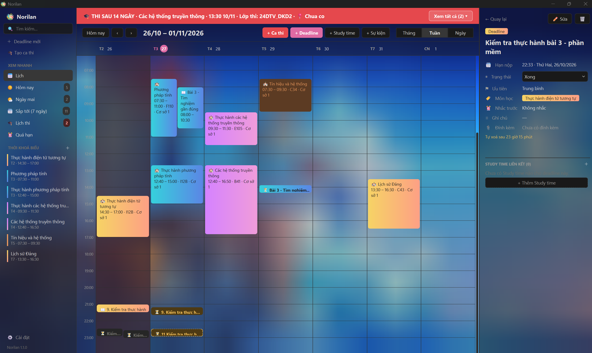
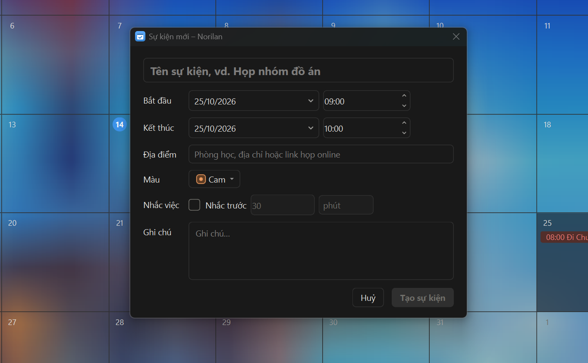
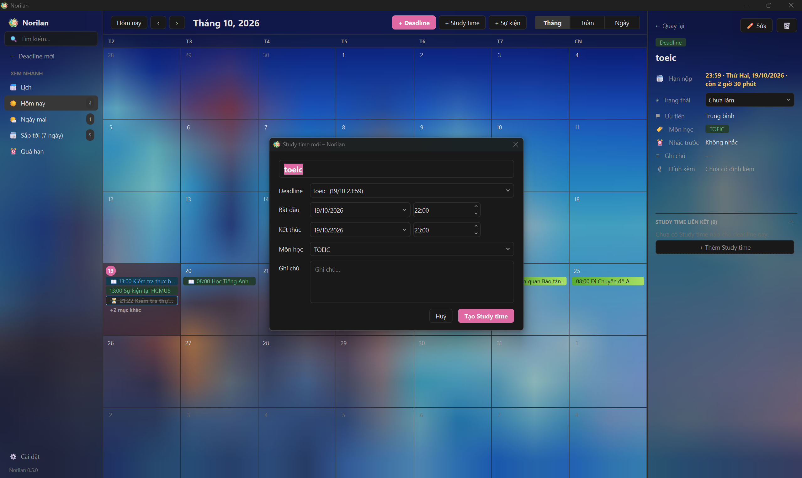
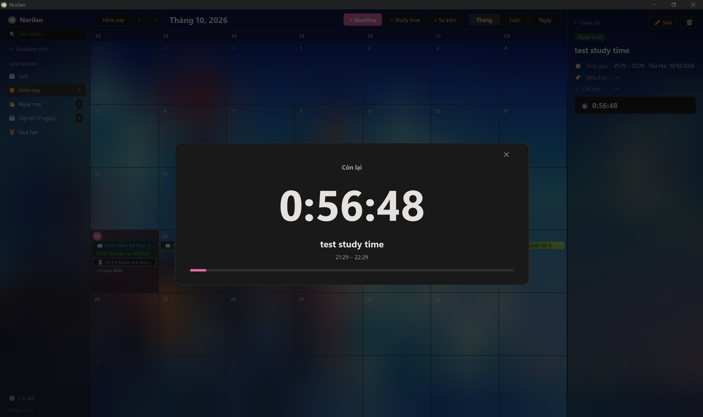
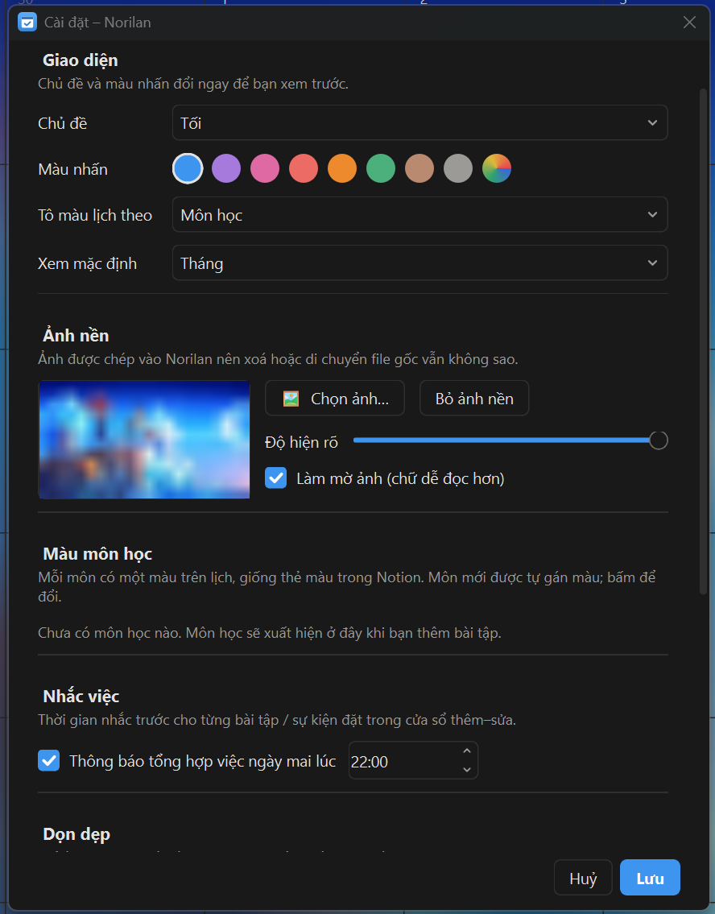
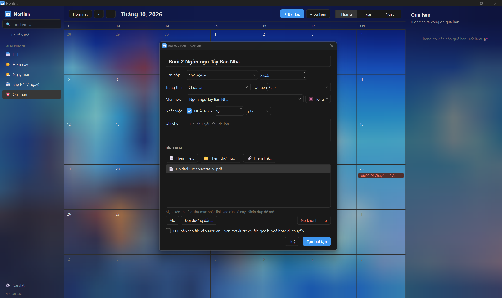
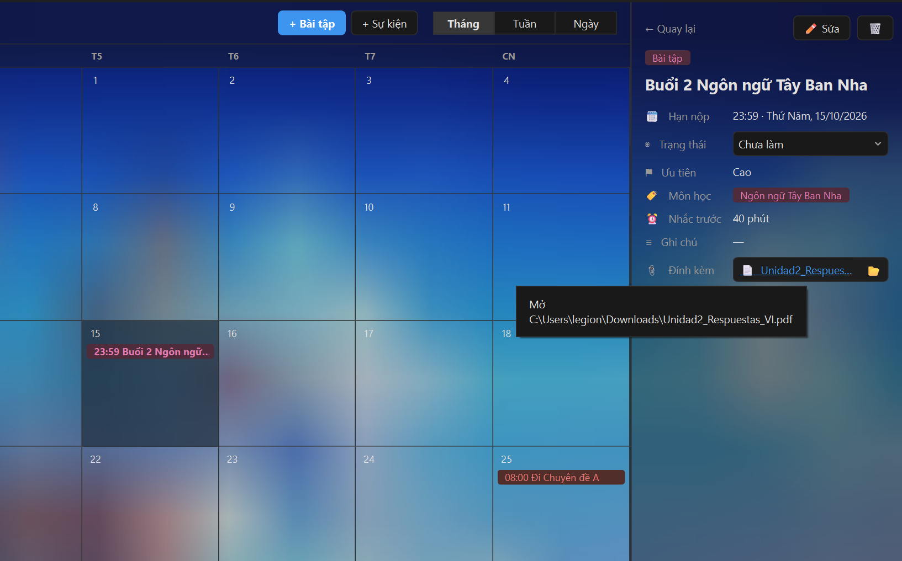

<div align="center">

# 📅 Norilan

**Ứng dụng desktop quản lý lịch, deadline & thời gian học thông minh cho Windows**

*Mở app, xem lịch, bấm vào deadline — file tài liệu mở ra ngay lập tức.*

[](https://python.org)
[](https://doc.qt.io/qtforpython/)
[](https://microsoft.com/windows)

</div>

---

## ✨ Tính năng nổi bật

| Tính năng | Mô tả |
|-----------|-------|
| 📆 **Lịch đa chế độ** | Xem theo Tháng / Tuần / Ngày, điều hướng mượt mà |
| 📚 **Deadline, Study time & Sự kiện** | Tạo, sửa, xoá; Deadline có trạng thái, ưu tiên, môn học, đính kèm; Study time là khoảng thời gian học (độc lập hoặc gắn với một Deadline) |
| 📎 **Đính kèm file** | Kéo-thả file/thư mục/link; bản sao lưu vĩnh viễn trong Norilan |
| 🔔 **Nhắc việc thông minh** | Toast Windows trước X phút/giờ/ngày + tổng hợp việc ngày mai mỗi tối |
| 🎨 **Giao diện đẹp** | Sáng / Tối / Theo Windows, ảnh nền mờ, màu theo môn học kiểu Notion |
| 🔍 **Tìm kiếm không dấu** | Tìm ngay không cần gõ dấu tiếng Việt |
| 💾 **Dữ liệu an toàn** | Sao lưu/khôi phục `.zip`, chạy nền ở khay hệ thống |
| 🚀 **Khởi động cùng Windows** | Tự động chạy ẩn ở khay khi bật máy |

---

## 🖼️ Giao diện

### Màn hình chính — Lịch tháng



> Lịch tháng với ảnh nền mờ đẹp. Sidebar trái lọc nhanh: **Hôm nay / Ngày mai / Sắp tới / Quá hạn**.
> Bấm vào sự kiện để xem chi tiết ngay bên phải mà không cần mở cửa sổ mới.

---

### Tạo Sự kiện mới



> Điền tên, chọn thời gian bắt đầu–kết thúc, địa điểm, màu sắc và bật nhắc nhở.
> Bấm **Tạo sự kiện** để lưu.

---

### Deadline kết hợp Study time



> Từ một **Deadline** (panel phải), bấm **+ Thêm Study time**: hộp thoại mở sẵn với cùng tiêu đề, đã liên kết với deadline
> và điền sẵn môn học. Phần *Study time liên kết* bên dưới liệt kê các buổi đã đặt (bấm để mở); chưa có buổi nào thì hiện
> nút thêm nhanh. Trên lịch và danh sách, Deadline có biểu tượng ⏳, chữ *còn …* (đổi màu cảnh báo khi dưới 24 giờ) và
> huy hiệu 📖 đếm số Study time đã đặt (0 được tô nổi bật để nhắc bạn dành thời gian làm).

---

### Đồng hồ đếm ngược Study time



> Bấm vào đồng hồ nhỏ dưới chi tiết Study time để phóng to: chữ số lớn, tên, khoảng giờ, thanh tiến độ.
> Dưới 10 phút chữ số đổi màu cảnh báo và Norilan gửi toast nhắc sắp hết giờ. Đóng bằng `Esc`, nút ✕ hoặc bấm nền mờ.

---

### Cài đặt



> Tuỳ chỉnh đầy đủ: chủ đề sáng/tối, màu nhấn, ảnh nền (ảnh được copy vào Norilan nên xoá file gốc vẫn không sao),
> màu theo môn học, thời gian nhắc tổng hợp và dọn dẹp tự động.

---

### Tạo Deadline — Có đính kèm file



> Đặt hạn nộp, trạng thái, ưu tiên, môn học và **đính kèm tài liệu học tập**.
> Tích ô *"Lưu bản sao file vào Norilan"* để file vẫn mở được dù file gốc bị xoá hay di chuyển.

---

### Chi tiết Deadline — Mở file đính kèm



> Bấm tên file để **mở file ngay lập tức** bằng ứng dụng mặc định.
> Hover chuột xem đường dẫn đầy đủ. Bấm biểu tượng 📁 để mở thư mục chứa file trong Explorer.

---

## ⚡ Dùng nhanh

### Thêm Deadline

```
Cách 1: Bấm nút  [+ Deadline]  trên thanh công cụ
Cách 2: Phím tắt  Ctrl + N
Cách 3: Nhấp đôi vào một ô ngày trên lịch
Cách 4: Rê chuột vào ngày → bấm nút  [+]  xuất hiện
```

Tạo Deadline mới xong, Norilan hỏi *"Đặt thêm thời gian để làm deadline này?"* — chọn **Có** để mở sẵn
hộp thoại Study time (cùng tiêu đề, đã liên kết với deadline).

### Thêm Study time

```
Cách 1: Bấm nút  [+ Study time]  trên thanh công cụ
Cách 2: Phím tắt  Ctrl + Alt + N
Cách 3: Mở một Deadline → phần "Study time liên kết" → [+ Thêm Study time]
```

Study time có thể đứng riêng (vd. "Học Tiếng Anh") hoặc gắn với một Deadline chưa xong (ô *Deadline*, mặc định
để trống). Một Deadline có thể có nhiều Study time. Tiêu đề chỉ được sao chép một lần lúc tạo, không đồng bộ về sau.
Xoá Deadline còn Study time liên kết → Norilan hỏi *xoá luôn* hay *giữ lại (gỡ liên kết)*; xoá Study time
không ảnh hưởng Deadline.

### Đồng hồ đếm ngược Study time

Chỉ có ở **Study time** (không có ở Deadline hay Sự kiện). Mở một Study time, dưới phần chi tiết có đồng hồ nhỏ:

```
• Đang diễn ra   →  ⏱ 0:45:00        (thời gian còn lại tới giờ kết thúc, đổi màu cảnh báo khi ≤ 10 phút)
• Chưa bắt đầu   →  Bắt đầu sau 1:02:03
• Đã kết thúc    →  Đã kết thúc
```

Ví dụ Study time 15:30 – 16:30: lúc 15:30 hiện `1:00:00`, lúc 16:30 hiện `0:00:00`, mở lúc 15:45 hiện `0:45:00`.
Đồng hồ luôn tính lại từ giờ hệ thống nên không bị lệch khi máy ngủ; chỉ chạy khi nó đang hiện trên màn hình.

**Phóng to:** bấm vào đồng hồ nhỏ → mở lớp phủ toàn cửa sổ với chữ số rất lớn, tên Study time, khoảng giờ,
deadline liên kết (kèm thời gian còn lại) và thanh tiến độ. Đóng bằng `Esc`, nút ✕ hoặc bấm vào nền mờ.
Lớp phủ không bao giờ tự mở; khi nó đang mở, phần giao diện bên dưới không thao tác được. Hết giờ khi đang mở thì
hiện *Đã kết thúc* và giữ nguyên cho tới khi bạn đóng.

**Cảnh báo 10 phút:** đúng 10 phút trước giờ kết thúc, Norilan gửi toast
*"Chuẩn bị hết thời gian làm bài: …"* (bấm vào toast để mở Study time đó). Toast chạy cả khi cửa sổ đã đóng xuống khay,
mỗi Study time chỉ một lần (đổi giờ kết thúc thì được cảnh báo lại). Study time ngắn hơn 10 phút không có toast; mở app
khi còn dưới 10 phút thì toast gửi ngay một lần.

### Thêm Sự kiện

```
Cách 1: Bấm nút  [+ Sự kiện]  trên thanh công cụ
Cách 2: Phím tắt  Ctrl + Shift + N
```

### Đính kèm file vào Deadline

```
Cách 1: Kéo-thả file / thư mục / link vào dialog deadline
Cách 2: Bấm nút [Thêm file...]     → chọn file
Cách 3: Bấm nút [Thêm thư mục..]  → chọn cả thư mục
Cách 4: Bấm nút [Thêm link...]    → dán URL
```

> 💡 **Mẹo quan trọng:** Tích ✅ *"Lưu bản sao file vào Norilan"* — Norilan tự sao chép file vào
> `%APPDATA%\Norilan\attachments\`. File vẫn mở được kể cả khi file gốc đã bị **xoá hoặc di chuyển**.
> Bản sao tự xoá khi bạn xoá deadline hoặc gỡ đính kèm.

### Mở file đính kèm

```
• Bấm vào deadline để mở chi tiết ở sidebar phải (phía dưới là các Study time liên kết)
• Bấm tên file           → mở file bằng ứng dụng mặc định
• Bấm biểu tượng 📁      → mở thư mục chứa file trong Explorer
• Chuột phải vào chip    → menu: Mở / Sửa / Gỡ đính kèm
• File bị mất            → app báo lỗi, cho chọn lại đường dẫn
```

---

## ⌨️ Phím tắt

| Phím tắt | Chức năng |
|----------|-----------|
| `Ctrl + N` | Thêm Deadline mới |
| `Ctrl + Alt + N` | Thêm Study time mới |
| `Ctrl + Shift + N` | Thêm sự kiện mới |
| `Ctrl + E` | Sửa mục đang xem |
| `Ctrl + F` | Mở ô tìm kiếm |
| `Ctrl + T` | Về hôm nay |
| `Ctrl + 1` | Chế độ xem Tháng |
| `Ctrl + 2` | Chế độ xem Tuần |
| `Ctrl + 3` | Chế độ xem Ngày |
| `Ctrl + ←` hoặc `PgUp` | Chuyển kỳ trước |
| `Ctrl + →` hoặc `PgDn` | Chuyển kỳ sau |
| `Ctrl + ,` | Mở Cài đặt |
| `Ctrl + Enter` | Lưu (trong dialog) |
| `Delete` | Xoá mục đang xem |
| `Esc` | Quay lại danh sách / Đóng tìm kiếm |
| `F5` | Làm mới giao diện |

---

## 🔔 Nhắc việc & Chạy nền

- **Bấm X** trên cửa sổ → Norilan thu xuống **khay hệ thống** (góc phải taskbar), vẫn chạy để nhắc việc
- **Thoát hoàn toàn:** Chuột phải biểu tượng ở khay → **Thoát**
- **Toast tổng hợp** mỗi tối (mặc định 22:00): *"Ngày mai bạn có N việc"* (mỗi ngày 1 lần)
- **Nhắc trước** X phút/giờ/ngày: đặt trong cửa sổ thêm/sửa deadline hoặc sự kiện
- **Sắp hết giờ làm bài:** toast riêng cho Study time, 10 phút trước giờ kết thúc (xem *Đồng hồ đếm ngược Study time*)
- **Bấm vào toast** → Norilan mở và cuộn đến đúng mục được nhắc
- **Khởi động cùng Windows:** Cài đặt → Hệ thống → bật *Khởi động cùng Windows* (chạy ẩn ở khay)

> **Thử nhanh:** Tạo deadline hạn nộp sau 10 phút, nhắc trước 5 phút → đợi toast xuất hiện.
> Hoặc vào Cài đặt → đặt giờ tổng hợp sớm hơn 1 phút so với giờ hiện tại (cần có việc ngày mai).
>
> **Thử cảnh báo hết giờ:** tạo Study time bắt đầu sau 1 phút, kết thúc sau 12 phút → toast hiện sau khoảng 3 phút
> (toast được kiểm tra mỗi ~20 giây nên có thể trễ tới 20 giây).

---

## 🎨 Màu sắc & Giao diện

- Mỗi **môn học có một màu riêng** (phong cách Notion), tự gán khác nhau
  - Đổi màu: bấm nút màu cạnh ô Môn học, hoặc vào **Cài đặt → Màu môn học**
- **Sự kiện** chọn màu riêng khi tạo/sửa
- **Cài đặt → Giao diện:**
  - Chủ đề: **Sáng / Tối / Theo Windows** (đổi là thấy ngay, bấm Huỷ để quay lại)
  - **Màu nhấn**: 8 màu có sẵn hoặc tuỳ chỉnh
  - Tô màu lịch: theo **Môn học** hoặc theo loại mục
- **Ảnh nền**: Cài đặt → Ảnh nền → Chọn ảnh
  - Ảnh được **sao chép vào Norilan** (thu nhỏ nếu > 2560px), xoá file gốc vẫn không sao
  - *Độ hiện rõ*: chỉnh độ trong suốt các ô lịch
  - *Làm mờ ảnh*: giúp chữ dễ đọc hơn

---

## 🔍 Tìm kiếm

- Ô tìm kiếm ở đầu sidebar (`Ctrl+F` để mở, `Esc` để xoá)
- Tìm theo: **tiêu đề, ghi chú, môn học, địa điểm**
- **Không cần gõ dấu** tiếng Việt: gõ `toan` → tìm được `Toán`, `thi hoc ky` → `Thi học kỳ`
- Lọc theo trạng thái ngay trong panel kết quả

---

## 💾 Dữ liệu & Sao lưu

| Mục | Đường dẫn |
|-----|-----------|
| Database | `%APPDATA%\Norilan\norilan.db` |
| Cài đặt | `%APPDATA%\Norilan\settings.json` |
| File đính kèm (bản sao) | `%APPDATA%\Norilan\attachments\` |
| Log | `%APPDATA%\Norilan\logs\norilan.log` |
| Sao lưu tự động | `%APPDATA%\Norilan\backups\` (giữ 5 bản gần nhất) |

**Sao lưu / Khôi phục:** Cài đặt → Dữ liệu

- Bản sao lưu là file `.zip` gồm: database, cài đặt, file đính kèm, ảnh nền
- Trước khi khôi phục, Norilan tự động sao lưu dữ liệu hiện tại vào `backups\`
- Có thể khôi phục sang máy khác ✅

**Tự xoá deadline đã xong:** Cài đặt → Dọn dẹp → chọn 7 / 14 / 30 / 90 ngày (mặc định tắt)

---

## 🛠️ Cài đặt & Chạy (Developer)

### Yêu cầu

- Python 3.11
- Windows 10 / 11

### Cài đặt môi trường

```powershell
py -3.11 -m venv .venv
.venv\Scripts\activate
pip install -r requirements-dev.txt
```

### Các lệnh chạy

```powershell
# Mở app thông thường (nếu đang chạy rồi thì đưa cửa sổ cũ lên trước)
python main.py

# Thêm dữ liệu mẫu rồi mở app
python main.py --seed

# Chạy ẩn ở khay (lệnh mà "Khởi động cùng Windows" dùng)
python main.py --background

# In tình trạng ra terminal (không mở cửa sổ)
python -m app.cli

# Tìm kiếm không dấu qua CLI
python -m app.cli --search "toan"

# Chạy test (giao diện chạy ẩn, không hiện cửa sổ)
pytest
```

### Biến môi trường

```powershell
# Dùng thư mục dữ liệu riêng khi dev (tránh ảnh hưởng dữ liệu thật)
$env:NORILAN_DATA_DIR = "$PWD\.devdata"
```

---

## 📦 Build file .exe

```powershell
pip install -r requirements-dev.txt

# Khuyên dùng: thư mục, khởi động nhanh
python build_exe.py              # → dist\Norilan\Norilan.exe

# Một file duy nhất, khởi động chậm hơn vài giây
python build_exe.py --onefile    # → dist\Norilan.exe
```

**Ghi chú khi phân phối:**

- Chạy thử: mở `dist\Norilan\Norilan.exe` — **không cần cài Python**
- Gửi sang máy khác: nén **cả thư mục** `dist\Norilan` thành `.zip`, giải nén rồi chạy `Norilan.exe`
- Dữ liệu vẫn ở `%APPDATA%\Norilan\` (dùng chung giữa bản source và bản .exe)
- Lần đầu chạy `.exe`, Windows SmartScreen có thể cảnh báo → **More info** → **Run anyway**
- Đã bật "Khởi động cùng Windows" ở bản source? Mở bản `.exe` một lần → lệnh khởi động tự chuyển sang `.exe`

---

## 🧱 Cấu trúc dự án

```
Norilan/
├── main.py                    # Điểm vào: mở giao diện
├── build_exe.py               # Script đóng gói .exe
├── requirements.txt
├── requirements-dev.txt
├── app/
│   ├── cli.py                 # CLI kiểm tra dữ liệu
│   ├── paths.py               # Đường dẫn dữ liệu
│   ├── timeutil.py            # Quy ước thời gian: ISO 8601, giờ local
│   ├── models.py              # Deadline, StudyTime, Event, Attachment (dataclass thuần)
│   ├── countdown.py           # Đếm ngược Study time: upcoming/running/ended, mốc cảnh báo 10 phút
│   ├── db.py                  # Kết nối, schema, migration, hàm fold()
│   ├── repository.py          # CRUD + truy vấn lịch/sidebar/tìm kiếm/nhắc việc
│   ├── settings.py            # settings.json (ghi atomic, chịu được file hỏng)
│   ├── logging_setup.py       # Log file xoay vòng + excepthook
│   ├── calendar_logic.py      # Logic lịch thuần (lưới tháng/tuần, nhãn tiếng Việt)
│   ├── files.py               # Đính kèm: nhận diện loại, kiểm tra, sao chép, mở
│   ├── colors.py              # Bảng màu kiểu Notion, màu môn học, màu nhấn
│   ├── reminders.py           # Quyết định khi nào nhắc + nội dung toast
│   ├── notifier.py            # Hiện toast bằng winotify
│   ├── links.py               # Link norilan://item/. và norilan://day/.
│   ├── system.py              # Registry Windows: khởi động, giao thức norilan://
│   ├── instance.py            # Chỉ cho chạy một bản
│   ├── tray.py                # Biểu tượng khay hệ thống
│   └── ui/
│       ├── main_window.py     # Cửa sổ chính
│       ├── sidebar.py         # Sidebar lọc nhanh + tìm kiếm
│       ├── calendar_views.py  # Lịch Tháng / Tuần / Ngày
│       ├── side_panel.py      # Panel chi tiết bên phải (+ đồng hồ nhỏ của Study time)
│       ├── overlay.py         # Lớp phủ đếm ngược toàn cửa sổ
│       ├── item_list.py       # Danh sách mục
│       ├── dialogs.py         # Dialog thêm/sửa deadline, study time & sự kiện
│       ├── settings_dialog.py
│       ├── app_controller.py  # Điều phối toàn bộ
│       ├── color_picker.py
│       ├── theme.py           # Sáng/Tối/Theo Windows
│       ├── widgets.py
│       ├── prompts.py         # Hộp thoại hệ thống
│       └── icon.py
└── tests/                     # pytest
```

---

## 🔧 Khắc phục sự cố

<details>
<summary><b>🔕 Không thấy toast nhắc việc</b></summary>

1. Vào **Windows Settings → System → Notifications** → đảm bảo thông báo đang **bật**
2. Kiểm tra không ở chế độ **Do not disturb / Focus Assist**
3. Xem log: `%APPDATA%\Norilan\logs\norilan.log` (tìm dòng *"Toast shown"* hoặc lỗi)

</details>

<details>
<summary><b>📎 File đính kèm báo không tìm thấy</b></summary>

- File gốc đã bị di chuyển/xoá mà chưa tích *"Lưu bản sao"*: app báo lỗi và cho chọn lại đường dẫn hoặc gỡ đính kèm
- Lần sau nên tích ✅ *"Lưu bản sao file vào Norilan"* khi tạo deadline

</details>

<details>
<summary><b>📁 Đã di chuyển thư mục dự án</b></summary>

Chỉ cần mở Norilan một lần → app tự cập nhật lại đường dẫn cho:
- Khởi động cùng Windows
- Link bấm toast (`norilan://`)

</details>

<details>
<summary><b>🛡️ Windows SmartScreen chặn file .exe</b></summary>

Bấm **More info** → **Run anyway**. File chưa có chữ ký số nên Windows cảnh báo lần đầu, hoàn toàn bình thường.

</details>

---

## 🗺️ Kế hoạch phát triển

- [ ] Nhân vật chibi dạng `.bbmodel` (Blockbench) làm **desktop pet** trên màn hình

---

<div align="center">

Made with ❤️ &nbsp;·&nbsp; Norilan v0.5.0

</div>
